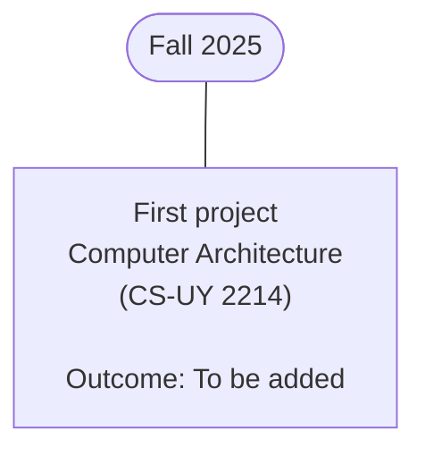

# Letter of Recommendations for Bao

For Professor Ratan Dey.

## Schools List and Deadlines

| School | Letter Deadline |
| --- | --- |
| University of California, Berkeley | January 5, 2027 |
| Columbia University | January 14, 2027 |
| Northwestern University | January 14, 2027 |
| University of Michigan | January 14, 2027 |
| Carnegie Mellon University | January 14, 2027 |
| Cornell University | January 14, 2027 |
| University of Pennsylvania | January 14, 2027 |

## Academic Performance

### My Courses with You

- Computer Architecture (CS-UY 2214): A-

### General

- Overall GPA: 3.677/4.000
- Major Requirement GPA: 3.677/4.000
- Advanced GPA (final 2 years): 3.896/4.000

## Resume

[View my resume (PDF)](Bao-Nguyen_resume.pdf)

## How You Know Me

### My Courses With You

- Computer Architecture (CS-UY 2214): A-

### Projects

- Team member of your VIP team Processor Design.

## Specific Work You Have Seen Me Do

## 2-3 Qualities I Hope You Will Highlight

## What I Am Applying For and Why
